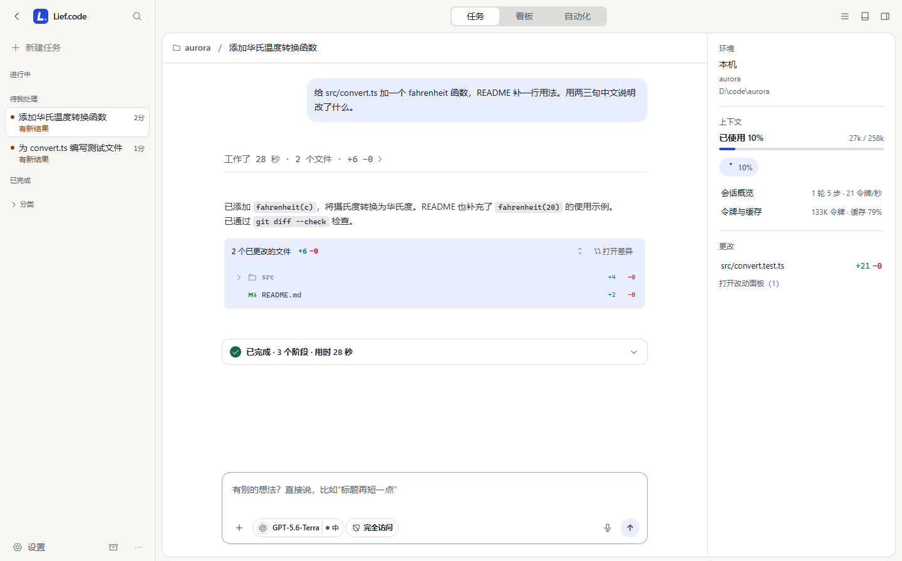
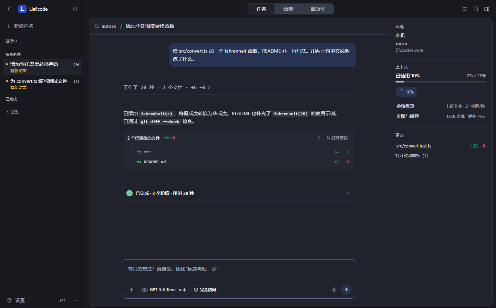

<div align="center">

# Lief.code

### The Local-First Command Bridge for Multi-Agent Software Engineering

**Run the coding agents you trust. Keep control of your code, credentials, and workspace on your own machine.**

[](https://github.com/LIAlia111/lief-code/releases)
[](LICENSE)
[](docs/user/install.md)
[](docs/user/telemetry.md)

**English** · [简体中文](./README.zh-CN.md)

</div>

---

Software engineering is crossing a structural threshold. The unit of work is no longer a single cursor typing one line at a time—it is an engineer directing a fleet of specialized coding agents in parallel across branches, repositories, and machines.

Yet the tooling around that shift remains fractured. One agent lives in a terminal tab, another inside a proprietary IDE, a third behind its own CLI and session format. Context shatters between tools. Branches collide. Quotas scatter across accounts. Rollbacks turn into guesswork.

**Lief.code** unifies that frontier into a single, local-first command workspace. Bring your own subscriptions, CLIs, and hardware—orchestrate **Codex, Claude Code, Cursor, Grok Build, OpenCode, Antigravity, Kiro, Pi, Muse Code, fx, and the ACP Registry** side by side with event-sourced durability, zero-noise Git checkpoints, and complete sovereignty over your machine.

<div align="center">

|                Day — Paper & Ink                 |                Night — Obsidian & Ink                |
| :----------------------------------------------: | :--------------------------------------------------: |
|  |  |

</div>

---

## Why Lief.code

Most tools force a false choice: lock yourself into one vendor's walled garden, or drown in a dozen disconnected terminals. Lief.code is built on a different premise:

- **One Bridge, Zero Lock-In** — Models and agents advance every month. Your workspace shouldn't be hostage to a single provider. Lief.code treats every supported provider CLI as a first-class citizen behind a unified adapter contract.
- **Local Sovereignty by Construction** — Lief.code runs on the machine that owns your workspace, and the providers you choose can process the context they need remotely. No Lief-hosted account, no cloud relay, no product analytics, no crash-report pipeline. Your code, secrets, and subscriptions stay yours.
- **Built for Parallelism, Not Just Chat** — A chat box is fine for one question. Shipping real systems demands isolated Git worktrees, non-destructive checkpoints, multi-repo orchestration, permission boundaries, and GitHub pull-request automation.
- **Calm, High-Density Craft** — Flat paper-and-ink aesthetics, Phosphor icons, and instant zero-lag panel transitions by default, designed for engineers who live in their tools all day—no clutter.

---

## One Bridge, Every Agent

Lief.code wraps the provider CLIs you already run and brings them into one coherent orchestration plane.

| Provider         | Integration                                      | Authentication                             |
| :--------------- | :----------------------------------------------- | :----------------------------------------- |
| **Codex**        | Native adapter + managed runtime option          | ChatGPT sign-in or `codex login`           |
| **Claude Code**  | Native adapter + subagent lineage & monitoring   | `claude auth login`                        |
| **Cursor**       | Native adapter (`cursor-agent`)                  | `agent login`                              |
| **Grok Build**   | Native adapter + subscription limit tracking     | `grok login`                               |
| **OpenCode**     | Native adapter (local & external server)         | `opencode auth login`                      |
| **Antigravity**  | Native adapter + managed runtime                 | Google sign-in in Settings                 |
| **Kiro**         | Native adapter                                   | `kiro-cli login`                           |
| **Pi**           | Native adapter                                   | `pi` + `/login`                            |
| **Muse Code**    | Native adapter                                   | `muse login`                               |
| **fx**           | Native adapter                                   | `fx login`                                 |
| **ACP Registry** | Generic ACP v2 preview & v1 + local ACP commands | Agent-native browser, terminal, or API key |

### Multi-Agent Capabilities That Actually Compose

- **Vendor-Pure Model Catalogs** — Single-vendor catalogs are filtered by model family, with custom entries still available, eliminating menu noise while multi-provider tools keep their mixed catalogs.
- **Multi-Account & Custom Instances** — Run multiple instances of the same provider, with separate accounts and custom endpoints where supported, and masked environment secrets.
- **Parallel Model Racing** — In a Git project, Shift-click models in a new thread’s model picker to dispatch the same prompt to multiple models at once; Lief.code spins up an isolated thread and Git worktree for every contestant automatically.
- **Portable Context Handoffs** — Switch providers mid-thread or recover across restarts without losing momentum. Lief.code transfers a budgeted, faithful selection of saved conversation history with references for retrieval. Provider reasoning, tool-call state, and attachments stay out of the handoff. Your current prompt stays intact.

---

## Engineered for Parallel Autonomy

### Three-Column Command Workspace

- **Focused Spatial Hierarchy** — Sidebar (**Active**, **Settled**, **Categories**) on the left, live execution and diff stream in the center, and a dense **Summary Rail** (**Environment**, **Context window**, **Quota**, **Changes**) on the right.
- **Three Operational Modes** — Switch cleanly at the top between **Tasks**, **Board** (with clear status reporting when its optional local task-board service is offline), and **Automation**.
- **Side Chats & Subagent Inspection** — Launch `/side` or `/btw` threads beside your active work without polluting the main conversation, and inspect delegated subagents side by side in the right panel.
- **Day, Night & System Themes** — Crafted around the Lief paper-and-ink palette with Phosphor icons (MIT), LaTeX math typesetting, built-in terminals, voice input, HTML visual renders, and **SnapShots** (desktop window capture by hotkey, attached directly to your draft with accessibility text when available).

### Event-Sourced Orchestration & Zero-Noise Checkpoints

- **Durable Core** — Commands flow through a serialized, event-sourced orchestrator (`Effect` + SQLite transactions) that commits events, UI projections, command receipts, and outbox effects atomically—decoupling state decisions from provider I/O.
- **Hidden Git Ref Checkpoints** — Turn checkpoints capture Git workspace snapshots as hidden refs without adding a single noisy commit to your branch. Multi-repository projects use sparse per-repo snapshots. Rewinding coordinates filesystem restoration with conversation rollback cleanly.
- **Isolated Worktrees & Multi-Repo Projects** — Spin up fresh Git worktrees per task or coordinate changes across dozens of repositories inside one project folder, with branch switching blocked while a thread is working in the same checkout.
- **Four-Tier Permission Guardrails** — Choose a provider-supported mode from **Supervised**, **Auto-accept edits**, **Auto**, and **Full access** per thread, with project defaults and machine policy limits. Subagent approvals surface directly in the parent conversation.

### End-to-End GitHub Workflow

- **Turn-Scoped Diffs** — Review the turn’s file changes, filtering out files brought in by Git alone during pulls, merges, or rebases.
- **Pull Requests, Stacks & Review Guides** — Generate commits and PR descriptions following repo conventions, navigate and rebase/merge **GitHub Stacks**, run AI-authored **Review Guides** that walk through large PRs in logical reading order, and manage **GitHub Issues** right next to your threads.
- **Autonomous PR Watching & Auto-Settlement** — Tell an agent to watch a pull request; the server monitors CI checks, reviews, and branch conflicts in the background, waking the agent when action is needed, including if github.com drops the PR from its merge queue. Eligible threads auto-settle after merge when enabled and can automatically run configured cleanup scripts (like `cargo clean`) in an isolated worktree.

### Unified Usage, Quotas & Cost Intelligence

- **Cross-Provider Ledger** — Aggregate token counts, cache hit savings, model breakdowns, and estimated API-equivalent costs across Codex, Claude Code, Grok Build, OpenCode, Antigravity, Pi, Muse Code, and Cursor.
- **Pooled Subscription Limits** — Track remaining session and weekly quotas across multiple accounts and connected machines (including CLIProxyAPI hubs), complete with reset countdowns, **Snooze until reset**, and automatic **Resume at reset** for limits with a reported reset time.

### Local-First, Multi-Machine Ready

- **Reach Your Hosts Anywhere—Directly** — Connect the desktop app or a browser over **LAN** or **Tailscale HTTPS**, or let the desktop app manage **SSH** (automatic runtime bootstrap & port forwarding), with multi-route failover, load balancing, and cross-machine **Linked Environments**.
- **First-Class WSL Integration** — On Windows, point Lief.code straight at a WSL distribution so Linux-native toolchains and provider CLIs run where they belong.
- **Built-In MCP Server & `lief` CLI** — Expose your Lief.code environment over OAuth-authenticated HTTP MCP (`/mcp`) so external agents (terminal Claude Code, Codex, ChatGPT, or custom bots) and shell scripts (`lief app`, `lief thread start`, `lief serve`, `lief pair`) can launch, steer, and read threads under explicit permission scopes.

---

## Architecture & Sovereignty

```text
┌─────────────────────────────────────────────────────────────────────────┐
│                       Your Clients (Desktop / Web)                      │
│         Electron Desktop App (Windows)  ·  Local & Remote Web UI        │
│                   Shared State: packages/client-runtime                 │
└────────────────────────────────────┬────────────────────────────────────┘
                                     │ Authenticated RPC (LAN / SSH / Tailscale)
┌────────────────────────────────────▼────────────────────────────────────┐
│                    Lief.code Local Environment Server                   │
│   Event-Sourced Orchestrator  ·  SQLite Projections  ·  MCP Server      │
│   Hidden-Ref Git Checkpoints  ·  Worktree Manager    ·  GitHub Sync     │
└───┬─────────┬─────────┬─────────┬─────────┬─────────┬─────────┬─────────┘
    │         │         │         │         │         │         │
  Codex    Claude    Cursor     Grok    OpenCode  Antigravity  Kiro / Pi / Muse / fx / ACP
```

- **Zero Product Telemetry & No Hosted Relay** — Lief.code collects no product analytics and sends no crash reports. Optional self-hosted OpenTelemetry (OTLP) export is available in Settings.
- **Transparent Outbound Requests** — Desktop update checks are off by default. About 45 seconds after server startup, usage warmup can fetch the public model price table if its cache is missing or stale. Public link icons can send the site’s hostname to Google’s favicon service. For these requests and provider version checks, see [Diagnostics](docs/user/telemetry.md).

---

## Getting Started

### Download for Windows

Windows is the tested primary platform.

1. Download **`Lief.code-0.1.11-x64.exe`** from [GitHub Releases](https://github.com/LIAlia111/lief-code/releases).
2. Run the per-user installer (installs under `%LOCALAPPDATA%\Programs\lief`).
3. Open **Settings → Providers** to enable the coding agent CLIs you already use, or configure a WSL distro under **Settings → Sharing & access**.

With the desktop app running, open any repository directly from its directory in your terminal:

```powershell
lief app
```

Or drive threads headlessly from scripts:

```powershell
lief thread start . "Audit our auth middleware for race conditions" --worktree main
```

### Build from Source

Prerequisites on Windows x64: Vite+ (`vp`), Node.js 26, `pnpm` via Corepack, Rust stable (`x86_64-pc-windows-msvc`), Python 3, and Visual Studio 2022 Build Tools (**Desktop development with C++**, Windows 10/11 SDK, and MSVC x64 Spectre-mitigated libraries). See the [development guide](docs/operations/development.md#first-checkout) and [local release guide](docs/operations/release.md).

```powershell
# Install dependencies
vp i

# Launch the desktop app in development mode
vp run dev:desktop

# Package the Windows x64 installer (output written to release/)
vp run dist:desktop:win:x64
```

---

## Documentation

- [Documentation Index](docs/README.md)
- [Install & Provider Setup](docs/user/install.md)
- [Working with Threads & Worktrees](docs/user/thread-sidebar.md)
- [Permission Modes](docs/user/permission-modes.md)
- [Source Control & GitHub Integration](docs/user/source-control.md)
- [Usage & Subscription Limits](docs/user/usage.md)
- [Remote Access (LAN, SSH & Tailscale)](docs/user/remote-access.md)
- [Outside Agents (MCP & CLI)](docs/user/outside-agents.md)
- [Diagnostics & Outbound Requests](docs/user/telemetry.md)
- [Architecture Overview](docs/internals/overview.md)
- [Development & Local Packaging](docs/operations/release.md)

---

## License & Acknowledgments

Maintained by **[Lief](https://github.com/LIAlia111)** and released under the **[MIT License](LICENSE)**.

Portions of the code originate from **T3 Code** (MIT); see [licenses/UPSTREAM-T3CODE.txt](licenses/UPSTREAM-T3CODE.txt).

Interface icons are from **Phosphor Icons** (MIT).

<div align="center">

<sub>Built for engineers who orchestrate intelligence—and refuse to surrender ownership of their craft.</sub>

</div>
