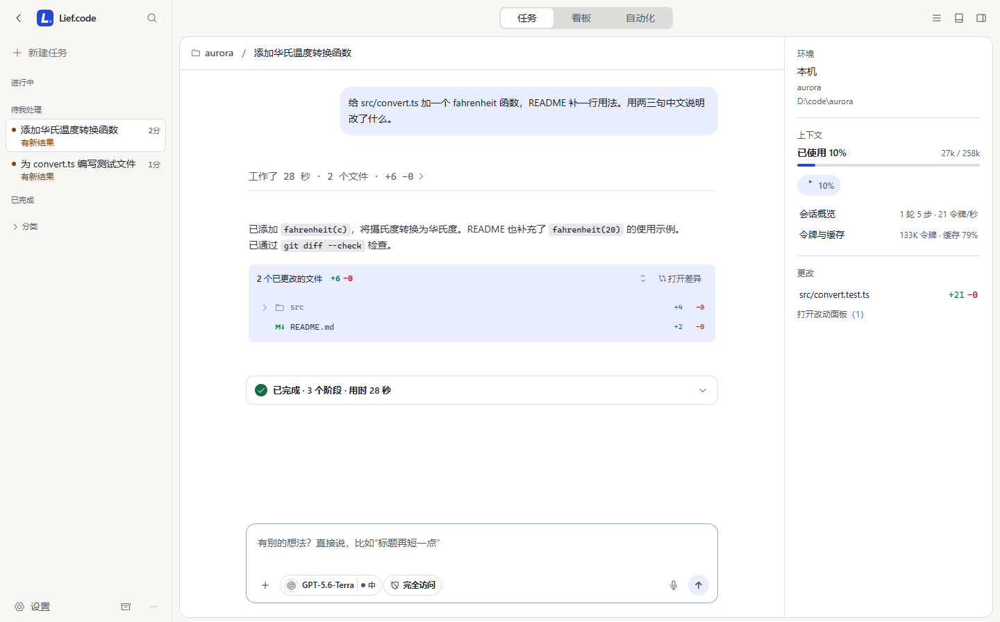
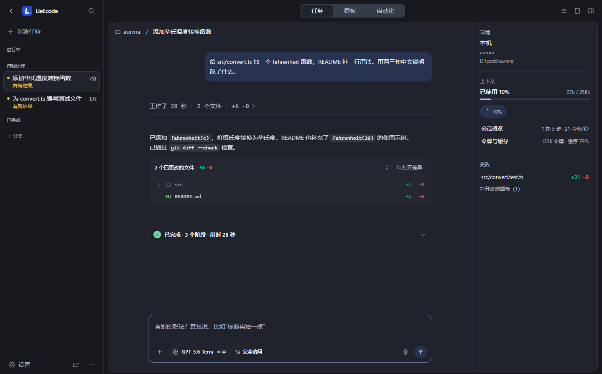

<div align="center">

# Lief.code

### 本地优先的多智能体软件工程指挥台

**汇聚你信赖的编码智能体，在自己的机器上握紧代码、凭证与工作台的控制权。**

[](https://github.com/LIAlia111/lief-code/releases)
[](LICENSE)
[](docs/user/install.md)
[](docs/user/telemetry.md)

[English](./README.md) · **简体中文**

</div>

---

软件工程正在经历一次彻底的范式迁徙。工作的最小单位，早已不再是一个人在编辑器里逐行敲击，而是工程师同时调遣多支 AI 编码战队，在多个分支、多个仓库甚至多台主机之间并行推进。

然而，当下的开发现场却被撕得支离破碎：Codex 跑在一个终端里，Claude Code 留在另一个窗口，Cursor、OpenCode、Grok、Antigravity、Kiro、Pi、Muse Code、fx 各自为政。上下文在工具切换间断裂，Git 分支彼此踩踏，订阅额度散落四处，代码改坏了无从优雅回退，工程资产被一层又一层封闭壳子割裂。

**Lief.code 为终结这种割裂而生。** 它是一座生长在你本地机器上的多 Agent 开发工作台：无需抛弃你已有的订阅与 CLI 工具，不必交出账号、代码或网络控制权，把十余种主流编码智能体收拢进同一张清晰、克制、工业级的指挥台。

<div align="center">

|                 白昼 · 纸墨素境                 |                  夜晚 · 玄墨深境                  |
| :---------------------------------------------: | :-----------------------------------------------: |
|  |  |

</div>

---

## 为什么是 Lief.code

在 AI 编程工具层出不穷的时代，真正稀缺的不是又一个模型壳，而是一套**以工程师为主权中心、经得起高并发实战的操作系统级工作台**：

- **万流归宗，绝不锁死单一厂商** —— 模型榜首每隔数月就会更迭，但你的工程工作流应当稳如磐石。Lief.code 以统一适配层纳管各大 Provider CLI，让你随时择强而用、自由组合。
- **彻底的本地主权** —— Lief.code 运行在代码所在的机器上，所选 Provider 可在远端处理所需的上下文。没有 Lief 托管账号，没有云端中继服务器，没有产品埋点，没有崩溃遥测。代码留在你的硬盘，凭证留在你的环境，所有权零让渡。
- **为并行实战设计，而非玩具聊天框** —— 真正的研发不是单轮问答，而是多任务并发、独立 Worktree 隔离、无痕 Git 检查点、多仓库协同、权限审批与 GitHub 全流程闭环。
- **纸墨美学，零噪专注** —— 扁平纸墨风格搭配 Phosphor 图标，克制的白昼 / 夜晚 / 跟随系统三主题，面板默认即时切换。

---

## 十路智能体，同台协同

Lief.code 直接接入你本机或远端主机上的编码智能体 CLI（自带订阅，原汁原味），并开放对 ACP 生态的原生支持：

| 接入方           | 支持形态                                 | 认证方式                     |
| :--------------- | :--------------------------------------- | :--------------------------- |
| **Codex**        | 原生适配 · 支持托管运行时                | ChatGPT 授权或 `codex login` |
| **Claude Code**  | 原生适配 · 子 Agent 谱系与状态追踪       | `claude auth login`          |
| **Cursor**       | 原生适配（`cursor-agent`）               | `agent login`                |
| **Grok Build**   | 原生适配 · 订阅额度追踪                  | `grok login`                 |
| **OpenCode**     | 原生适配（本地及外部服务）               | `opencode auth login`        |
| **Antigravity**  | 原生适配 · 支持托管运行时                | 设置内 Google 登录           |
| **Kiro**         | 原生适配                                 | `kiro-cli login`             |
| **Pi**           | 原生适配                                 | `pi` + `/login`              |
| **Muse Code**    | 原生适配                                 | `muse login`                 |
| **fx**           | 原生适配                                 | `fx login`                   |
| **ACP Registry** | 通用 ACP v2 preview / v1 及本地 ACP 命令 | 浏览器、终端或环境变量密钥   |

### 让多智能体真正形成合力

- **厂商纯净模型过滤** —— 单一厂商的目录按模型系列筛选，仍可保留自定义模型，告别冗杂错乱的模型列表；多厂商工具则保留混合目录。
- **多账号与独立实例** —— 同一个 Provider 可配置多个实例，在支持的情况下使用独立账号、自定义网关，并可隐藏环境变量中的敏感值。
- **同题并行竞速** —— 在 Git 项目中新建任务时按住 `Shift` 点击多个模型，一键发出同一份需求，Lief.code 自动为每个模型拉起独立线程与独立 Git Worktree，互不干扰，高下立判。
- **跨 Provider 交接（Portable Handoffs）** —— 任务中途想从 Claude 切到 Codex，或从中断会话恢复？Lief.code 按预算精确移交已保存的关键对话历史，并附上回溯引用。Provider 的推理、工具调用状态和原有附件留在原会话，当前指令保持完整。

---

## 工业级工程底座

### 一目了然的三栏指挥台

- **克制高效的空间布局** —— 左侧边栏管理「进行中」「已完成」「分类」（支持置顶、拖拽排布、延后唤醒、折叠后台运行中线程）；居中承载主对话与代码流；右侧摘要栏实时呈现「环境」「上下文」「额度」「改动」。
- **三大作战视图** —— 顶部一键切换 **任务（Tasks）**、**看板（Board）**（可选本地任务看板服务，离线时清晰提示状态）与 **自动化（Automation）**。
- **旁路追问与子 Agent 并排审视** —— 用 `/side` 或 `/btw` 在右侧面板开启不污染主线的旁路会话；点击子 Agent 卡片即可在侧栏实时跟进，主线进度丝毫不乱。
- **趁手的高频兵器** —— 内置终端、LaTeX 公式渲染、语音输入、HTML 可视化回复渲染，以及 **SnapShots**（桌面端按热键截取当前窗口，直接附到草稿，并在可用时附带无障碍文本）。

### 事件溯源引擎与无痕检查点

- **经得起重启的编排内核** —— 服务端基于 `Effect` 与 SQLite 事务构建事件溯源编排器：命令串行决策，事件、视图投影、幂等回执与 Outbox 副作用在单事务内原子落盘，与外部 Provider I/O 彻底解耦。
- **零污染隐藏 Git Ref 检查点** —— 轮次检查点通过隐藏 Git ref 记录 Git 工作区快照，绝不在你的提交历史里留下任何垃圾 commit；多仓库项目采用稀疏快照，只为发生改动的仓库落盘；一键回退时文件状态与对话历史协同回滚。
- **Worktree 隔离与多仓联合项目** —— Git 项目中的并行任务可运行在独立的 Git Worktree 中，支持单项目托管数十个代码仓库；同一工作区有线程正在工作时会禁止切换分支。
- **四级权限护栏** —— 按线程灵活选择 Provider 支持的 **需审批（Supervised）**、**自动接受编辑（Auto-accept edits）**、**自动（Auto）** 或 **完全访问（Full access）**，项目可设默认值，整机策略可限制可用模式，子 Agent 审批统一收归父会话处理。

### GitHub 全链路研发闭环

- **聚焦本轮的精准 Diff** —— 自动滤除仅由 pull / merge / rebase 带入的文件，聚焦本轮文件改动。
- **PR 堆栈、审阅导览与 Issues 联动** —— 按仓库规范自动生成 Commit 与 PR 文案；原生支持 **GitHub Stacks** 层级浏览、变基与整栈合并；Beta 版 **Review Guides** 可由 AI 按阅读逻辑串联大型 PR 的关键停靠点；GitHub Issues 直接在工作台内关联、筛选与处理。
- **PR 自动哨兵与自动结项** —— 让智能体盯守一个 PR，服务端在后台轮询 CI 检查、评审评论与分支冲突，在需要处理时唤醒智能体，也会响应 github.com 将 PR 移出合并队列的情况。开启自动结项后，符合条件的线程会在 PR 合并后结项，并可在独立 Worktree 中触发已配置的清理脚本（如 `cargo clean`）释放磁盘。

### 全域用量账本与额度池

- **跨工具成本全景** —— 自动汇总 Codex、Claude Code、Grok Build、OpenCode、Antigravity、Pi、Muse Code 与 Cursor 的 Token 消耗、缓存命中节省、模型拆解与估算 API 等效成本。
- **多账号额度池与限额自动续跑** —— 将多台主机、多个账号乃至 CLIProxyAPI Hub 的订阅额度汇聚为一目了然的剩余窗口与重置倒计时；Provider 报告重置时间时，支持「延后至重置」与「重置后自动续跑」，无需人工守夜。

### 扎根本地，连通多机

- **点对点跨机直连** —— 桌面端或浏览器可通过 **局域网（LAN）** 或 **Tailscale HTTPS** 直连工作站，桌面端也可托管 **SSH**（自动部署远端运行时并建立端口转发）；支持多路由自动切换、多机负载均衡（Auto balance）与跨环境任务委派（Linked Environments）。
- **原生衔接 WSL** —— 在 Windows 桌面端直接绑定 WSL 发行版，让 Linux 工具链与智能体 CLI 在最顺手的系统里运行。
- **内置 MCP Server 与 `lief` CLI** —— 提供基于 OAuth 的 HTTP MCP 端点（`/mcp`），让外部终端里的 Claude Code、Codex、ChatGPT 或自定义机器人，以及本地脚本（`lief app`、`lief thread start`、`lief serve`）都能在细粒度权限控制下驱动你的工作台。

---

## 本地主权契约

```text
  [ Windows 桌面端 / 本地与远端 Web UI ]
                     │  鉴权 RPC（LAN / SSH / Tailscale）
                     ▼
  [ Lief.code 本地编排服务 · 运行在代码所在的主机 ]
    事件溯源 · SQLite 投影 · 隐藏 Git Ref 检查点 · MCP 服务 · GitHub 同步
                     │
                     ▼
  Codex · Claude Code · Cursor · Grok · OpenCode · Antigravity · Kiro · Pi · Muse Code · fx · ACP
```

- **绝不收集产品埋点与崩溃报告** —— 如需可观测性，可在设置中对接你自建的 OpenTelemetry（OTLP）接收端。
- **内置出站请求公开透明** —— 桌面端自动更新检查默认关闭。服务启动约 45 秒后会预热用量统计，定价缓存缺失或过期时可拉取公开模型价格表。公开链接的图标可能向 Google 的图标服务发送网站主机名。上述请求及 Provider 版本检查见 [诊断与出站说明](docs/user/telemetry.md)。

---

## 快速启程

### Windows 桌面端安装

Windows 是 Lief.code 的实测主力平台。

1. 前往 [GitHub Releases](https://github.com/LIAlia111/lief-code/releases) 下载安装包 **`Lief.code-0.1.11-x64.exe`**。
2. 运行安装程序（默认按当前用户安装至 `%LOCALAPPDATA%\Programs\lief`，无需管理员权限）。
3. 打开 **设置 → 智能体提供方** 启用你已安装的智能体 CLI，或在 **设置 → 共享与访问** 中绑定 WSL 发行版。

桌面端运行时，在任意仓库目录的终端里敲下一行命令，即可直接唤起工作台：

```powershell
lief app
```

也可以在脚本或终端中直接派发任务：

```powershell
lief thread start . "排查鉴权中间件的并发竞态并补齐测试" --worktree main
```

### 从源码构建

Windows x64 环境需准备：Vite+（`vp`）、Node.js 26、Corepack 启用的 `pnpm`、Rust stable（`x86_64-pc-windows-msvc` 目标）、Python 3，以及 Visual Studio 2022 Build Tools（勾选「使用 C++ 的桌面开发」、Windows 10/11 SDK 与 MSVC x64 Spectre 缓解库）。详见 [开发指南](docs/operations/development.md#first-checkout) 与 [本地打包指南](docs/operations/release.md)。

```powershell
# 安装依赖
vp i

# 启动桌面端开发环境
vp run dev:desktop

# 打包 Windows x64 安装程序（产物输出至 release/）
vp run dist:desktop:win:x64
```

---

## 文档导航

- [文档总目录](docs/README.md)
- [安装与 Provider 配置](docs/user/install.md)
- [线程、Worktree 与并行工作流](docs/user/thread-sidebar.md)
- [权限模式说明](docs/user/permission-modes.md)
- [GitHub 源码与 PR 集成](docs/user/source-control.md)
- [用量统计与额度池](docs/user/usage.md)
- [远程访问（LAN / SSH / Tailscale）](docs/user/remote-access.md)
- [外部智能体（MCP 与 CLI）](docs/user/outside-agents.md)
- [诊断与出站请求说明](docs/user/telemetry.md)
- [架构设计总览](docs/internals/overview.md)
- [本地构建与发布手册](docs/operations/release.md)

---

## 开源协议与致谢

本项目由 **[Lief](https://github.com/LIAlia111)** 维护，基于 **[MIT License](LICENSE)** 开源发布。

部分代码源自 **T3 Code**（MIT），见 [licenses/UPSTREAM-T3CODE.txt](licenses/UPSTREAM-T3CODE.txt)。

界面图标采用 **Phosphor Icons**（MIT）。

<div align="center">

<sub>献给驾驭智能体、却永不让渡工具主权的工程师。</sub>

</div>
